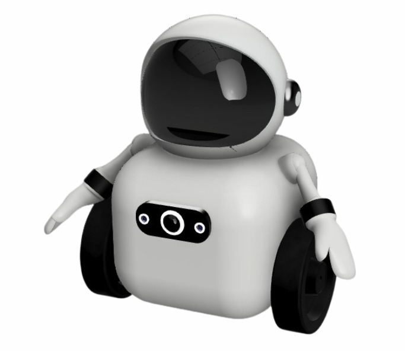

# RBE-01 — Robô educativo da sala criativa

Robô móvel que vai trabalhar na **sala de educação criativa**, no meio de crianças
e do professor. Ele interage com as crianças usando o conteúdo da sala: vai até a
mesa de uma criança, reconhece quem ela é, para de frente e conversa com ela.

É a **continuação do [`Controle_robo_web`](https://github.com/LGSantarosa/Controle_robo_web)**
(robô 1), que foi o protótipo do robô educativo. Este aqui é o projeto real, feito
do jeito que deveria ter sido desde o começo. Ele é **totalmente independente** do
robô 1 e do robô 3 (`Controle_robo_livox`): não tem código, histórico nem pacote
compartilhado com nenhum dos dois. Desses projetos herdamos só as **lições**
(ver [decisão 000](docs/decisoes/000-projeto-independente.md)).

## Fase atual: base móvel

O corpo vem depois. **Por enquanto o foco é a base**: uma plataforma que anda bem,
navega sozinha pela sala, para com precisão na frente de uma mesa e volta sozinha
pra carregar.

| Tema | Decisão | Doc |
|---|---|---|
| Projeto | independente, continuação conceitual do robô 1 | [000](docs/decisoes/000-projeto-independente.md) |
| Cinemática | diferencial, rodas motoras no **meio**, omni na frente e atrás | [001](docs/decisoes/001-cinematica-diferencial-rodas-centrais.md) |
| Tração | cubo servo AGV **ZLTECH 5,5"** + driver **ZLAC8015D** por RS485 | [002](docs/decisoes/002-tracao-zltech-hub-servo.md) |
| Energia | **2 baterias iguais**: tração / computação | [003](docs/decisoes/003-energia-duas-baterias.md) |
| Carga | **estação de carga autônoma** (ele vai e encaixa sozinho) | [004](docs/decisoes/004-estacao-de-carga-autonoma.md) |
| Navegação | **Nav2** + LiDAR 2D **LD06** + **IMU**, mini PC tipo **NUC** | [005](docs/decisoes/005-navegacao-nav2-ld06-imu.md) |
| Controle | `ros2_control` direto no driver, **sem microcontrolador na tração** | [006](docs/decisoes/006-software-ros2control-direto.md) |
| Elétrica | parecida com o robô 1; **e-stop na traseira corta só as rodas**; sem LED; **sem microcontrolador** | [007](docs/decisoes/007-eletrica-e-emergencia.md) |

- **Estado vivo** (o que está aberto, próximos passos): [`ESTADO_PROJETO.md`](ESTADO_PROJETO.md)
- **Design da base** (o documento completo): [`docs/design/2026-11-05-base-movel.md`](docs/design/2026-11-05-base-movel.md)
- **Diário**: [`docs/DIARIO.md`](docs/DIARIO.md)
- **Conceito visual**: [`docs/conceito/`](docs/conceito/) (modelo SketchUp `RBE-01.skp` + render)
- **Driver ZLAC8015D** (registradores, protocolo): [`docs/hardware/zlac8015d.md`](docs/hardware/zlac8015d.md)

